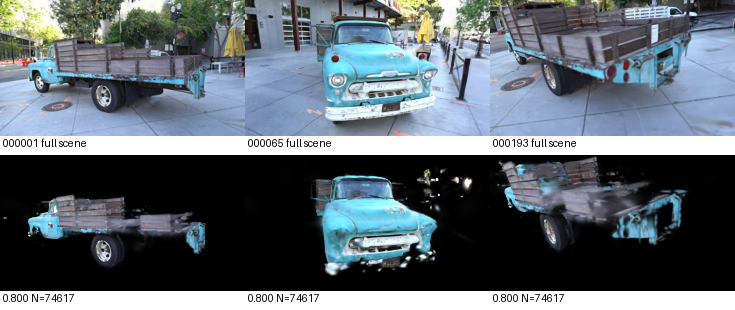

# Person 3, week 1 — SAGA on the truck scene

The experiment tests whether the pinned SAGA v2 baseline can produce a
point-order-aligned truck mask on a Windows laptop. The provisional scene is
the Tanks and Temples `truck` example. The target is the truck, including
its cab, wheels and cargo bed. The ground, buildings and trees are background.

## Result

The selected mask contains **74,617 of 693,896 Gaussians (10.75%)**.
The three held-out renders show the cab, wheels and cargo bed. A few background
fragments remain near the truck, and parts of the bumper and cargo-bed edges
are incomplete or blurred. This is a working baseline for comparison and
handoff. No reference 3D labels were available to measure segmentation IoU.



| Stage | Observed result | Time |
| --- | --- | ---: |
| Scene training | 7,000 iterations, 693,896 Gaussians saved | ~135 s |
| SAM ViT-B | 251 image masks | 670 s |
| Scale extraction | 251 camera scale files | 15.2 s |
| Feature training | 2,000 iterations and learned scale gate | 159.0 s |
| Click scoring and export | 74,617 Gaussians and three views | 4.5 s |

Selection peak PyTorch allocation was 656,371,200 bytes (626 MiB), excluding
driver allocations. Training peak VRAM was not measured.
`results/selection.json` records the selected bounds, source and export hashes
and an approximate connected-component check. A 26-neighbor voxel grid
with cell size 0.5795 scene units found 57 occupied components, with 2,090
selected points outside the largest. The grid statistics depend on that
resolution and do not identify ground truth outliers.

The 7,000-step scene run produced a PLY with 693,896 Gaussians. Scene training
uses 219 views and holds out 32, including the three views used for visual
review. `source.json` identifies the exact source PLY and the dataset archive.
Use its SHA-256 to verify the PLY before applying any labels. Re-training can
change the PLY and row order, so labels from this run require its exact PLY.

## Reproduction

Use the pinned SAGA revision and the Windows environment in
`experiment.yaml` and `environment.txt`. The SAGA rasterizers and
PyTorch3D were compiled locally for CUDA capability 12.0. For builds with
spaces in the Windows profile, a temporary drive mapping provided space-free
CUDA toolkit and compiler temporary paths.

Run the commands from the pinned SAGA checkout. In PowerShell, set `$python`
to the SAGA environment's Python executable, `$scene` to the extracted
`tandt/truck` directory, `$model` to the model output directory, `$sam` to the
downloaded SAM checkpoint and `$experiment` to this experiment directory.
Create `images_4` under the scene with the same JPEG filenames as `images`,
using OpenCV linear resizing to 245 × 136. This matches the SAGA camera
loader's rounded dimensions. Keep the source photographs in `images`.

```powershell
& $python train_scene.py -s $scene -m $model -r 4 --data_device cpu --eval --iterations 7000 --save_iterations 7000 --test_iterations 7000
& $python extract_segment_everything_masks.py --image_root $scene --sam_checkpoint_path $sam --sam_arch vit_b --downsample 4
& $python "$experiment/prepare_scales.py" --saga (Get-Location).Path --scene $scene --model $model
& $python "$experiment/train_features.py" --saga (Get-Location).Path --model $model
```

`prepare_scales.py` exposes both camera splits to SAGA's `get_scale.py`.
The original command processed 219 cameras, but feature training reads
masks and scales for all 251 cameras before splitting views. The wrapper
leaves the `--eval` split intact for scene and feature optimization.

The initial feature run stopped when nonfinite scales made a maximum-scale
reduction empty. `train_features.py` drops each unusable scale together with
its corresponding mask slice. It removed 981 of 13,338 mask/scale pairs
while preserving every camera, all scene Gaussians and the original SAM files.

The 7,000 scene and 2,000 feature iterations, quarter-resolution input and
SAM ViT-B are Windows laptop settings. Upstream's default experiment uses
30,000 and 10,000 iterations and SAM ViT-H.

## Click selection

`select_truck.py` implements the pinned GUI's click scoring with recorded
camera names and pixel coordinates. It uses the learned scale gate at 0.5,
computes normalized feature similarity and takes the union of the mask
selected by each positive click. The implementation runs without the GUI.
No additional geometric filtering was applied.

Three clicks in one view kept the near wheel, cab and some of the bed but
missed much of the front and rear. The final run uses 13 clicks in four
training views. Thresholds 0.70, 0.75, 0.80, 0.85 and 0.90 were compared.
Lower thresholds admitted visibly more background. At 0.85 and above,
parts of the bumper and bed dropped out. Threshold 0.80 was chosen by
visual review. `000001`, `000065` and `000193` were held out from scene
and feature optimization and were not used as prompt views.

```powershell
$record = Get-Content "$experiment/results/selection.json" -Raw | ConvertFrom-Json
$prompts = foreach ($click in $record.clicks) { '--click'; $click }
& $python "$experiment/select_truck.py" --saga (Get-Location).Path --model $model --scene $scene --out ./truck-export @prompts --scale 0.5 --threshold 0.8 --export
```

## Handoff

`results/mask.bits.gz` contains one bit per source PLY row. The local
delivery archive includes the matching source PLY, `mask.npy` (boolean),
`object_id.npy` (uint16), and the feature checkpoint. The source PLY
and feature PLY agreed exactly in vertex count and XYZ row sequence.
Neither file was reordered to make the mask.

Decode and verify the committed mask using the exact source PLY.
The script checks the source SHA-256 and vertex count and verifies that both
recreated NumPy files match the export hashes. The label values are
`0` for background and `1` for the truck.

```powershell
& $python "$experiment/unpack_mask.py" --source "$model/point_cloud/iteration_7000/scene_point_cloud.ply" --results "$experiment/results" --out ./truck-labels
```

The repository contains the packed mask, report, scripts and renders. The
matching large checkpoints are in the local delivery archive and can be
placed on team storage for review.
